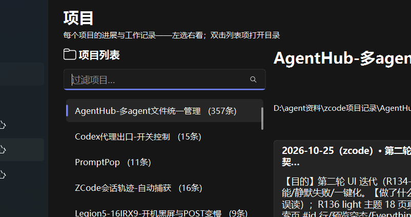

# CodexNetSwitch

Codex 桌面版网络开关 —— 为「第三方 API + 国内直连」场景一键控制 Codex 的境外后台连接。

## 解决什么问题

用第三方 provider（如 DeepSeek）跑 OpenAI Codex 桌面版时，对话流量走国内 API 本来就快，
但应用启动时仍会尝试连接 OpenAI 侧的境外服务（登录检查 / 特性开关 / 遥测上报 / 插件目录同步）。
在出境网络不通的环境下，这些请求每个都要等满超时，导致启动巨慢。

本工具通过 hosts 把这些**本来就在失败**的境外域名劫持到回环地址，让请求毫秒级失败、
不再傻等超时——启动立刻恢复流畅，对话流量完全不受影响。

## 功能

- **红绿灯总评**：打开就是一句话——"✅ 一切正常" / "⚠ codex 启动会慢（建议点XX）" / "⚠ 对话接口连不上"，不用自己看懂各项指标
- 一键启用 / 停用屏蔽（改 hosts 时弹 UAC 确认，平时无需管理员运行）
- `statsigapi.net` 单独放行开关（清单中唯一的公共域名，防其他软件被误伤）
- 浅色 / 深色双主题（右上角切换，自动记忆）；全控件悬停气泡白话注释；帮助区带名词速查
- deepseek 对话 API 连通性实时检测；FlClash 进程与代理端口状态
- 开机自启（最小化）；诊断报告一键复制；hosts 外部手改 2 秒内自动感知
- hosts 安全链：写前滚动备份 3 份 → 残缺块拒绝写入 → 原子替换 → 写后回读验证
- 技术详情（状态卡 / 域名清单）默认折叠，状态每 15 秒自动刷新

## 界面

浅色 / 深色双主题（右上角一键切换，自动记忆）：

| 浅色 | 深色 |
|------|------|
|  |  |

## 使用

1. 安装 Python 3.8+（仅标准库，无第三方依赖）
2. 双击 `codex_net_switch.pyw`，或按下方「构建」打包成单个 exe

界面按钮：

| 按钮 | 效果 |
|------|------|
| 启用屏蔽 | hosts 写入屏蔽块，境外请求快速失败 |
| 停用屏蔽 | 移除屏蔽块，恢复直连（用 OpenAI 官方账号前请先停用） |
| statsig 放行/恢复 | 单独控制公共域名 statsigapi.net，其余屏蔽不变 |

## CLI

```
codex_net_switch.pyw --status            # 状态 JSON 含解析 IP（只读）
codex_net_switch.pyw --selftest          # 14 项逻辑自测（不碰真实 hosts）
codex_net_switch.pyw --apply             # 启用屏蔽（需管理员）
codex_net_switch.pyw --remove            # 停用屏蔽（需管理员）
codex_net_switch.pyw --statsig on|off    # statsigapi.net 屏蔽/放行（需管理员）
codex_net_switch.pyw --diagnose          # 诊断报告文本（排障用）
codex_net_switch.pyw --minimize          # 启动后最小化（配合自启）
codex_net_switch.pyw --version|--help    # 版本 / 帮助
```

## 构建（PyInstaller）

```
pip install pyinstaller
python -m PyInstaller --onefile --noconsole --name CodexNetSwitch \
    --icon icon.ico --add-data "icon.ico;." codex_net_switch.pyw
# 产物 dist/CodexNetSwitch.exe（约 11 MB，Windows 10/11）
```

## 屏蔽清单（2026-10 实测取证）

| 域名 | 用途 |
|------|------|
| auth.openai.com | 登录态检查（API key 模式不需要） |
| api.openai.com | OpenAI API / 插件目录（已被第三方 provider 替代） |
| statsigapi.net | 特性开关（公共域名，可单独放行） |
| statsigcdn.openai.com | 特性开关 CDN |
| ab.chatgpt.com | A/B 实验配置 |
| codex-portals.api.openai.com | 云通道（MASQUE） |
| o33249.ingest.us.sentry.io / o33249.ingest.sentry.io | 错误遥测（Sentry） |

> Codex 版本大更新后若启动又变慢，可能是遥测域名更换，欢迎提 issue 更新清单。

## 原理与边界

- hosts 无通配符，域名逐条劫持到 `127.0.0.1` + `::1`
- 本机 443 无监听 → 连接立即被拒（快速失败语义）
- 屏蔽块带 `>>> CODEX-OFFSHORE-BLOCK >>>` 标记，工具只增删自己的块，不碰 hosts 其他内容
- 需要临时用回 OpenAI 官方账号 / 云端功能时，一键停用即可

## License

MIT
